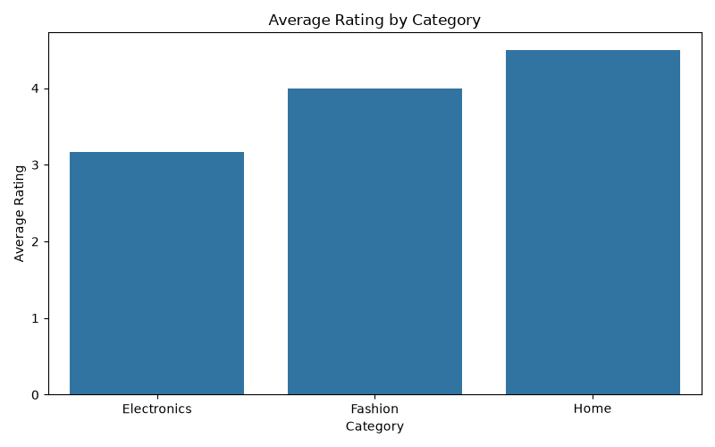
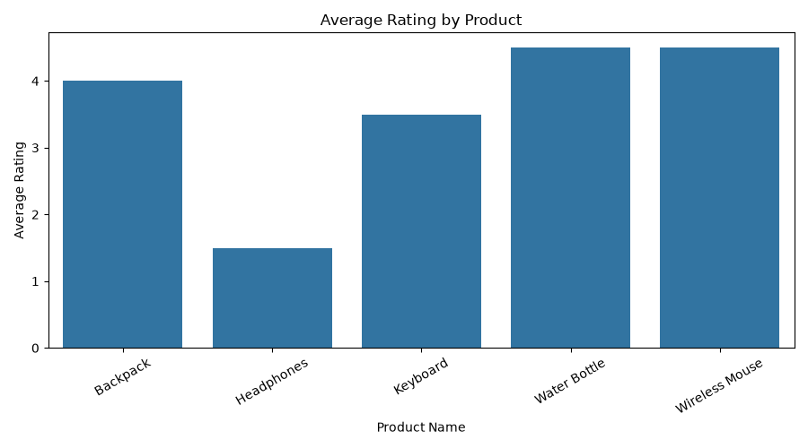
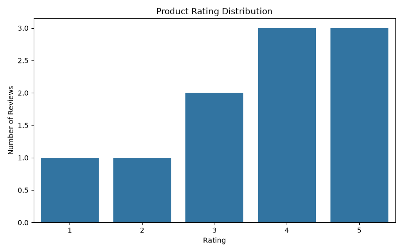

# Product Review Data Analysis & Customer Insights System

## Project Overview
This project analyzes product reviews and customer ratings to identify product performance and customer insights using Python, data analysis, visualization, and SQL.

## Technologies Used
- Python
- Pandas
- NumPy
- Matplotlib
- Seaborn
- SQLite
- SQL

## Features
- Dataset loading and exploration
- Missing values and duplicate checks
- Product rating analysis
- Highest- and lowest-rated product identification
- Category-wise rating analysis
- Rating distribution visualization
- Data cleaning and cleaned dataset export
- SQL database creation and queries

## Project Files
- `product_review_customer_insights.py` – Main Python program
- `product_reviews.csv` – Original dataset
- `cleaned_product_reviews.csv` – Cleaned dataset
- `product_reviews.db` – SQLite database
- `rating_distribution.png` – Rating distribution chart
- `product_ratings.png` – Product rating chart
- `category_ratings.png` – Category rating chart

## How to Run
1. Install the required libraries:
   `pip install pandas numpy matplotlib seaborn`
2. Run the Python program:
   `python product_review_customer_insights.py`

## Project Outcome
The project generates product-wise and category-wise rating summaries, saves visualizations, cleans the dataset, and stores review data in an SQLite database.
## Project Visualizations

### 1. Category Ratings

### 2. Product Ratings

### 3. Rating Distribution

## Author
Lavanya D
